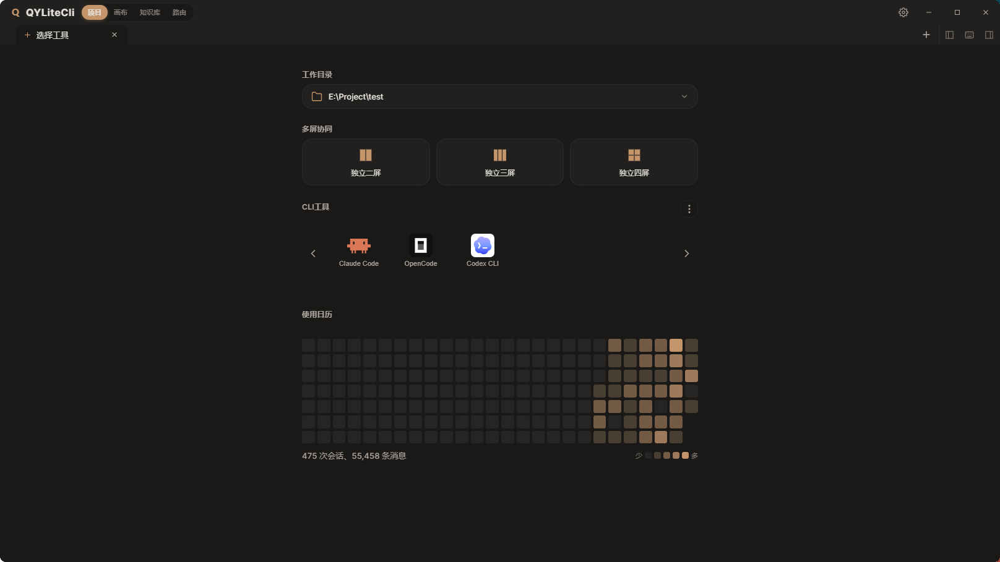
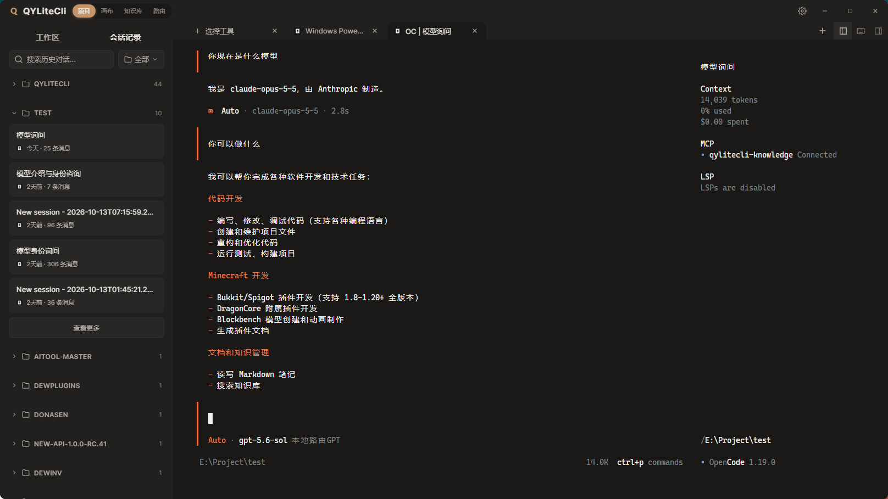
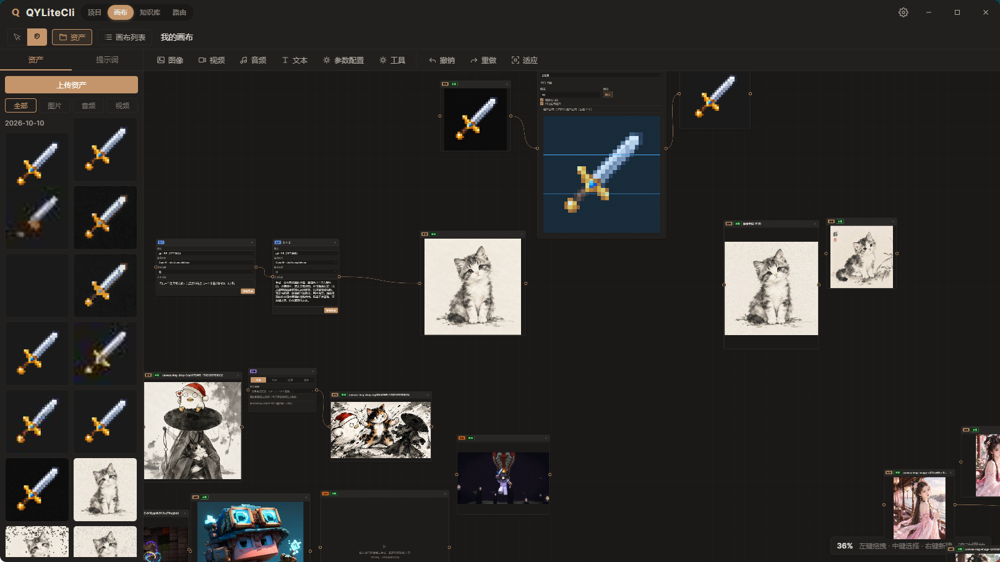
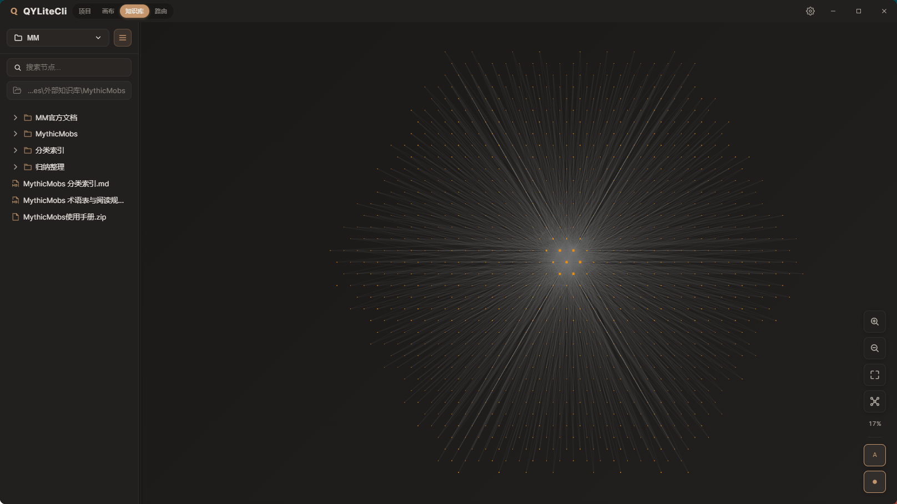
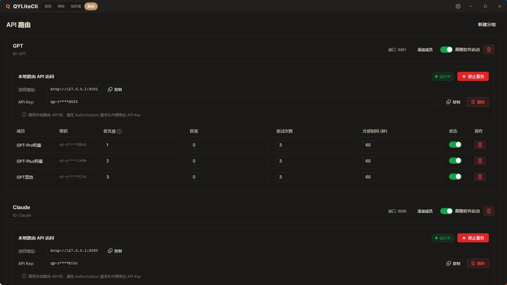
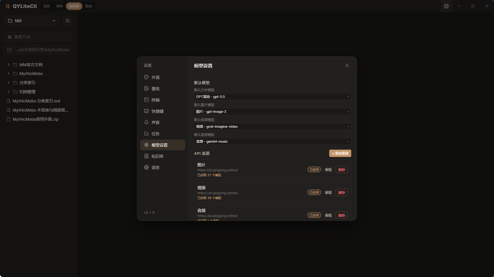

<!--
插图都放在 docs/images/ 文件夹里。
换成自己的界面截图时，保持文件名不变，直接覆盖即可，不用改下面的路径。
如果想改文件名，再一起改对应的图片路径。

01-home.png        打开软件后的整体样子，能看到顶部四个切换
02-project.png     项目：选好文件夹、和助手对话
03-canvas.png      画布：白板上连着文字、图片等卡片
04-knowledge.png   知识库：笔记列表和关系图
05-routing.png     路由：把多个账号编成一组
06-settings.png    设置：外观、壁纸、提示音、语言
-->

# QYLiteCli

一个放在电脑上的工作窗口。和智能助手一起处理文件、在白板上做图和视频、整理自己的笔记，都在这里完成。

窗口最上方有四个名字，点一下就能换过去：**项目**、**画布**、**知识库**、**路由**。

[下载 Windows 安装包](https://github.com/Donasens/QYLiteCli-updata/releases/latest)

## 打开之后

装好后双击打开。最上面可以切换四个空间，需要时再点进设置，改外观、壁纸和提示音。

## 项目

先选一个文件夹。之后就在这个文件夹里，和助手一起查看、修改文件。

- 直接对话，让助手帮你看文件、改文件
- 改过的地方会单独列出来，方便核对后再留下这一版
- 可以记任务，分成进行中、待办和已完成
- 画面可以分成几块，同时做几件事
- 需要时，也可以连到另一台电脑上继续操作

## 画布

一张可以随意拖动、放大缩小的白板。

把文字、图片、视频、声音放上去，用线连起来，再写出你想要的效果。生成的结果会出现在新的卡片上。

图片还能在这里直接处理：裁切、旋转、缩放、去掉背景、加一圈边、修补小瑕疵，或把一张图拆开。做好的图片、声音和视频可以收在旁边，下次拖出来继续用。常用的说法也可以存下来。

左上角可以在「点选卡片」和「拖动画布」之间切换。

## 知识库

用来整理自己的笔记和文件。可以建好几个库，每个库对应电脑上的一个文件夹。

- 笔记之间可以互相提到，点一下就能跳过去
- 可以打开一张关系图，看这些笔记是怎么连在一起的
- 写笔记时可以看原文、看排版后的样子，也可以左右对照
- 文件夹里的其他文件也会出现在列表里

## 路由

手里有多个模型账号时，可以把它们编成一组，并排好先后。

前面的暂时用不了，就会自动试下一个，不用每次自己改。这一组也可以单独打开或关掉。

## 按自己的习惯调整

在设置里可以改这些：

- 外观，以及用图片或视频当壁纸
- 提示音：事情做完，或需要你确认时响一声
- 界面语言
- 任务列表的样子

## 怎么开始

1. 下载安装包，双击安装
2. 打开 QYLiteCli
3. 想先和助手一起改文件，就留在「项目」，选一个文件夹
4. 想做图或整理笔记，点顶部换成「画布」或「知识库」

有新版本时，软件会自己提示，按提示安装即可。

目前提供 Windows 安装包。
